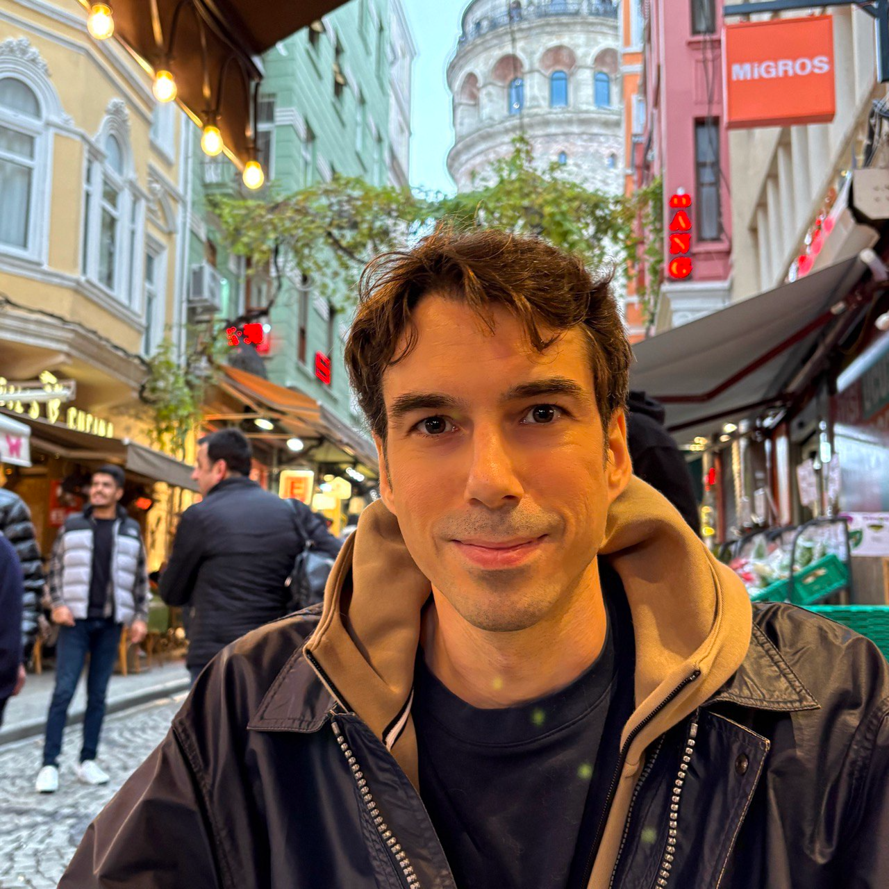

@def title = "Emanuele Natale | AI for Science"
@def tags = ["syntax", "code"]

~~~

~~~

CNRS research scientist and [3IA Côte d'Azur][3IA] Chair (INRIA / Université Côte d'Azur).

[GitHub](https://github.com/natema) · [graph-theory-AI](https://github.com/graph-theory-AI) · [Google Scholar](https://scholar.google.com/citations?user=m2P3BH4AAAAJ) · [LinkedIn](https://www.linkedin.com/in/enatale) · [X](https://x.com/emanatale) · [CV](/cv/) · [Contact](/contact/)

### My research

Recently, I have been building systems on top of frontier language models.
I led **[Mathpocalypse](https://github.com/graph-theory-AI/mathpocalypse-project)**, in which an open-weight LLM re-checked 646 published mathematics papers for errors, and I co-lead **[Graph-Theory-LLM-Proofs](https://github.com/graph-theory-AI/Graph-Theory-LLM-Proofs)**, in which reasoning models attempt more than a thousand open problems in graph theory.
I also started **[Leanamics](https://formal-dynamics.github.io/leanamics/)**, a Lean 4 library in which AI agents formalize published results on opinion dynamics.

More broadly, I study fundamental mathematical and algorithmic aspects of intelligent systems, with a focus on efficient neural networks, multi-agent computation, and brain-inspired models.
My work spans machine learning, computational neuroscience, and distributed systems.

I give a quick overview of my contributions [here](/research/#research_bio). See also my [AI projects & software](/software/).

### About me

I am a tenured research scientist (HDR) at [CNRS] (the French national research agency), based at [Université Côte d'Azur][UCA], where I hold a Chair at the [3IA Côte d'Azur][3IA] AI institute. I am a member of the [COATI Project-Team][COATI] between [INRIA] and [I3S][I3S], and the coordinator of the [ELECTRON Associated INRIA Team](https://team.inria.fr/electron/) with King's College London.
Currently, I am a long-term visitor in Prof. Petra Mutzel's group at [University of Bonn](https://www.informatik.uni-bonn.de/en/) and a member of the [Lamarr Institute](https://lamarr-institute.org/).

~~~

<a itemprop="sameAs" content="https://orcid.org/0000-0002-8755-3892" href="https://orcid.org/0000-0002-8755-3892" target="orcid.widget" rel="me noopener noreferrer" >https://orcid.org/0000-0002-8755-3892</a>

 
~~~

### Short Bio

Before accepting a CNRS position in 2018, I've been a fellow of the [*Simons Institute for the Theory of Computing*](https://simons.berkeley.edu/) in the Brain and Computation Program and a postdoctoral fellow at the [*Max Planck Institute for Informatics*](https://www.mpi-inf.mpg.de/departments/algorithms-complexity).
In 2019, I've received the *Best Italian Young Researcher in Theoretical Computer Science* award by the Italian Chapter of the European Association of Theoretical Computer Science, from which I also received the *Best PhD Thesis in Theoretical Computer Science* in 2017. In 2016, I've been a recipient of the *Best Student Paper Award* at the European Symposium on Algorithms.  
I have led two national research projects funded by the French Directorate General of Armament: *BraInside* (2019-23), which focused on neural network pruning, and *BioSwarm* (2024-27), which focused on bio-inspired strategies for drone swarms.
For more information (projects, academic service etc.), see my [CV](/cv/).

[3IA]: https://3ia.univ-cotedazur.eu/
[UCA]: http://univ-cotedazur.fr
[COATI]: https://team.inria.fr/coati/team-members
[I3S]: http://www.i3s.unice.fr
[CNRS]: https://www.cnrs.fr/
[INRIA]: https://www.inria.fr/en/inria-centre-universite-cote-azur
